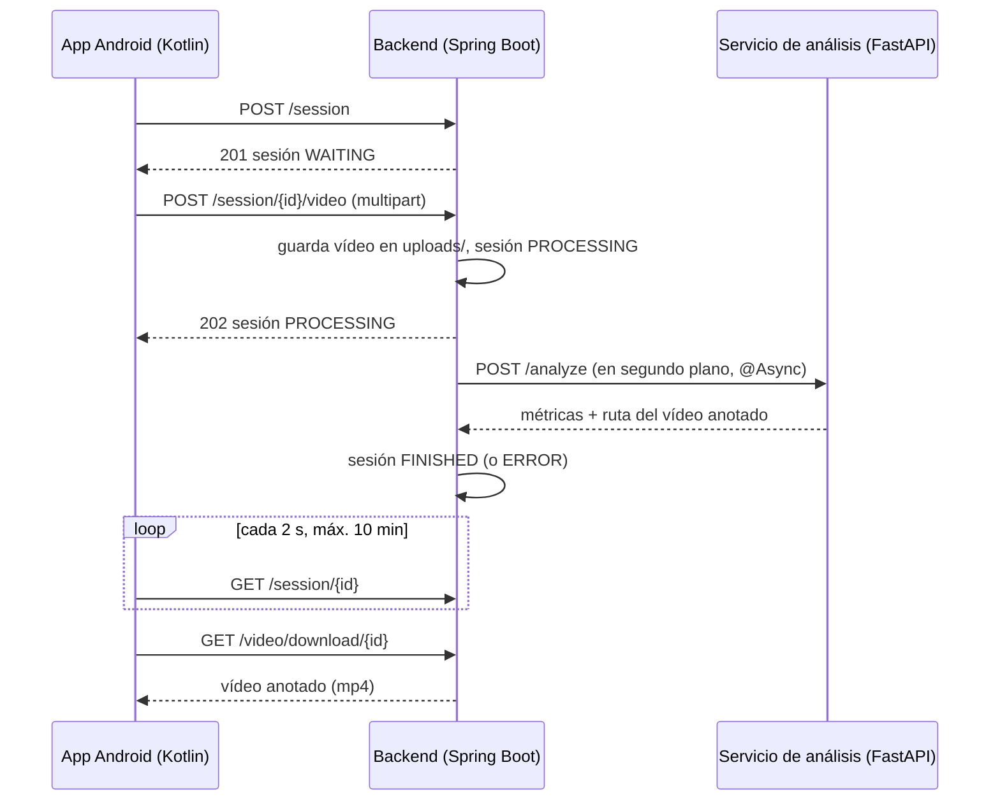
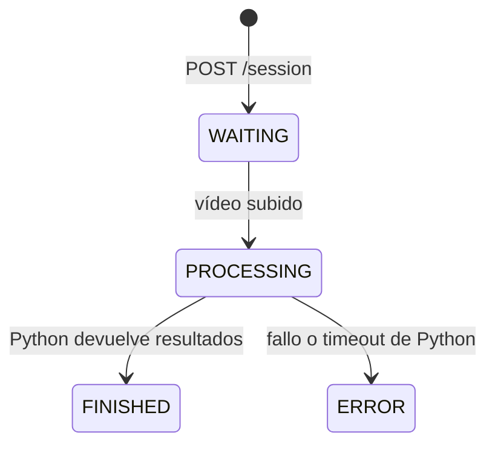

# Arquitectura de PowerMetrics

PowerMetrics analiza vídeos de ejercicios de fuerza (hoy, la sentadilla) con visión artificial. La app Android sube el vídeo, el backend Java orquesta el proceso y un servicio Python con MediaPipe extrae las métricas. Este documento es la referencia para retomar el desarrollo: qué hace cada pieza, cómo se comunican y cómo se ejecutan.

> Pendientes y deuda técnica: [PENDIENTES.md](PENDIENTES.md).

## Vista rápida

## Componentes

| Componente | Carpeta | Stack | Puerto |
|---|---|---|---|
| App móvil | `FEPerfectSquat/` | Kotlin 2.2, Jetpack Compose, Retrofit 2.9, minSdk 24 | — |
| Backend | `BEPerfectSquat/` | Java 17, Spring Boot 3.4, JPA + H2 en memoria | 8080 |
| Servicio de análisis | `PYAnalysisService/` | Python, FastAPI, MediaPipe 0.10.14, OpenCV | 8000 |

## Backend (`BEPerfectSquat`)

Organizado en capas, de fuera hacia dentro:

| Capa | Paquete | Responsabilidad |
|---|---|---|
| API | `api/controller`, `api/dto`, `api/exception` | Adaptador HTTP, contrato público y mapeo de errores |
| Dominio | `domain/entity`, `domain/service`, `domain/repository`, `domain/enums` | Sesiones, vídeos, reglas de estado |
| Infraestructura | `infrastructure/client`, `infrastructure/service`, `infrastructure/config` | Cliente HTTP a Python, almacenamiento en disco, `RestTemplate` |

> Las entidades JPA son a la vez modelo de dominio y de persistencia. No es arquitectura hexagonal estricta: el dominio depende de `AnalysisClient` y de `StorageService` sin puertos intermedios.

### Endpoints

| Método | Ruta | Respuesta | Uso |
|---|---|---|---|
| POST | `/session` | 201 `AnalysisSessionResponse` | Crea una sesión en `WAITING` |
| GET | `/session/{id}` | 200 `AnalysisSessionResponse` | Consulta estado y métricas (la app hace polling aquí) |
| POST | `/session/{id}/video` | 202 `AnalysisSessionResponse` | Sube el vídeo (`file`, `weightKg` opcional) y lanza el análisis |
| POST | `/video` | 201 `VideoResponse` | Subida alternativa (`sessionId`, `file`, `weightKg`); duplica la anterior |
| GET | `/video?sessionId=` | 200 `VideoResponse` | Datos del vídeo de una sesión |
| GET | `/video/download/{sessionId}` | 200 mp4 / 404 | Descarga el vídeo anotado |
| — | `/h2-console` | — | Consola de la base de datos (solo desarrollo) |

### Ciclo de vida de una sesión

- Solo se acepta vídeo en `WAITING`; en otro estado responde 400.
- Solo se guardan resultados en `PROCESSING`; en otro estado responde 409.
- `AnalysisRunner.analyze` corre en otro hilo (`@EnableAsync`). Cualquier excepción deja la sesión en `ERROR`.
- Timeouts hacia Python: 5 s de conexión y 10 min de lectura (`RestTemplateConfig`).

### Modelo de datos

| Entidad | Campos clave | Relación |
|---|---|---|
| `AnalysisSession` | `state`, `createdAt`, `weightKg`, `totalReps`, `validReps`, `avgConcentricVelocity`, `estimatedRM`, `fatigueIndex` | 1–1 `Video`, 1–N `RepDetail` |
| `Video` | `filePath`, `processedFilePath`, `uploadedAt` | pertenece a una sesión |
| `RepDetail` | `repNumber`, `valid`, `minHipAngle`, `minKneeAngle`, `concentricVelocity` | pertenece a una sesión |

Los vídeos se guardan en `BEPerfectSquat/uploads/` con nombre UUID; el anotado lleva el sufijo `_analyzed.mp4`. La carpeta está en `.gitignore`.

## Servicio de análisis (`PYAnalysisService`)

**Contrato** (`app/models.py`):

| Petición `POST /analyze` | Respuesta |
|---|---|
| `sessionId`, `videoFilePath` (ruta absoluta en disco), `weightKg?` | `sessionId`, `processedVideoFilePath`, `totalReps`, `validReps`, `reps[]`, `averageConcentricVelocity`, `estimatedRM`, `fatigueIndex` |

> Python lee y escribe el vídeo **en el mismo disco que el backend**, a partir de la ruta que recibe. Ambos servicios tienen que correr en la misma máquina.

### Algoritmo de sentadilla (`services/squat_analyzer.py`)

1. **Lado del cuerpo**: elige izquierda o derecha según la visibilidad media de cadera, rodilla y tobillo; si es menor de 0,3, descarta el frame.
2. **Ángulos**: rodilla (cadera–rodilla–tobillo) y cadera (hombro–cadera–rodilla), suavizados con una media móvil exponencial (α = 0,2).
3. **Máquina de estados** sobre el ángulo de rodilla:

| Transición | Condición |
|---|---|
| `STANDING → DESCENDING` | rodilla < 150° |
| `DESCENDING → ASCENDING` | la rodilla sube más de 15° sobre el mínimo de la repetición |
| `ASCENDING → STANDING` | rodilla > 160°; cuenta la repetición si la subida duró ≥ 0,25 s |

4. **Profundidad** (`services/depth.py`): una repetición es válida si la cadera queda por debajo de la rodilla (`hip.y > knee.y` en coordenadas de imagen) durante al menos 2 frames consecutivos. Es una aproximación con los centros articulares.
5. **Métricas**:

| Métrica | Cálculo | Ojo |
|---|---|---|
| `concentricVelocity` | `1 / tiempo de subida` | Está en 1/s, no en m/s: solo sirve para comparar repeticiones entre sí |
| `estimatedRM` | Epley: `peso × (1 + 0,0333 × repeticiones válidas)` | Solo si se envía `weightKg` |
| `fatigueIndex` | `1 − v_última / v_primera`, con mínimo 0 | Necesita al menos 2 repeticiones |

## App Android (`FEPerfectSquat`)

| Pieza | Fichero | Notas |
|---|---|---|
| Navegación | `ui/navigation/AppNavigation.kt` | Menú, Iniciar análisis, Resultado, Histórico, Estadísticas |
| Estado | `ui/viewmodels/MainViewModel.kt` | Crea la sesión, sube el vídeo, hace polling y descarga el resultado |
| Red | `network/ApiService.kt`, `network/RetrofitClient.kt` | `BASE_URL = http://10.0.2.2:8080/` (emulador → localhost) |

> Histórico y Estadísticas son pantallas de relleno: el backend todavía no tiene un endpoint para listar sesiones.

## Cómo ejecutarlo en local

| Paso | Comando |
|---|---|
| 1. Servicio de análisis | `cd PYAnalysisService && pip install -r requirements.txt && cd app && python main.py` |
| 2. Backend | `cd BEPerfectSquat && ./mvnw spring-boot:run` |
| 3. App | Abrir `FEPerfectSquat/` en Android Studio y ejecutar en el emulador |

## Tests

| Módulo | Comando | Notas |
|---|---|---|
| Backend | `cd BEPerfectSquat && ./mvnw test -DargLine=-Dnet.bytebuddy.experimental=true` | El flag hace falta con JDK 25 (Mockito) |
| Python | `cd PYAnalysisService && py -m unittest discover -s tests` | Solo lógica pura (`depth.py`); no necesita MediaPipe |
| App | Android Studio | Solo existen los tests de ejemplo |

## Convenciones de trabajo

- **Ramas**: `feat/...`, `fix/...` sobre `main`; nunca trabajar directamente en `main`.
- **Commits**: Conventional Commits (`feat(backend): ...`, `fix(analysis): ...`), un commit por unidad de trabajo, con sus tests.
- **Seguimiento de features grandes**: `odd/tasks/<feature>.md` (especificaciones, tareas y bitácora).
- **Idioma**: código e identificadores en inglés; documentación, comentarios y textos de la UI en español.
