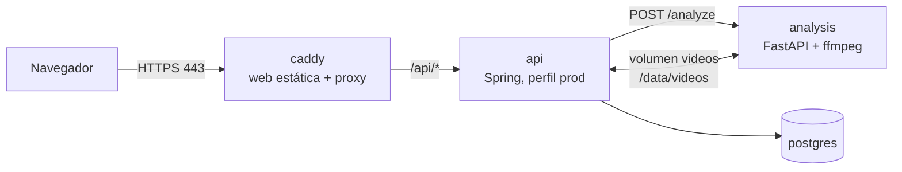

# Despliegue de PwrMetrics

PwrMetrics corre en **un único VPS con Docker Compose**: Caddy sirve la web y el API en el mismo dominio con HTTPS automático, y el backend, el servicio de análisis y PostgreSQL quedan en la red interna.

> Arquitectura y límites de uso: [ARQUITECTURA.md](ARQUITECTURA.md).

## Qué se levanta



| Servicio | Imagen | Expuesto | Datos persistentes |
|---|---|---|---|
| `caddy` | `deploy/Caddy.Dockerfile` (compila `web/` y la sirve) | 80, 443 | `caddy_data` (certificados) |
| `api` | `BEPerfectSquat/Dockerfile` | no | volumen `videos` |
| `analysis` | `PYAnalysisService/Dockerfile` (Python 3.12 + ffmpeg) | no | volumen `videos` |
| `postgres` | `postgres:16-alpine` | no | `pgdata` |

`api` y `analysis` montan el volumen `videos` en la **misma ruta** (`/data/videos`): el API le pasa a Python la ruta del fichero, no el fichero.

## Requisitos del VPS

- Linux con Docker Engine y el plugin Compose.
- 4 GB de RAM y 2 vCPU como mínimo: cada análisis con MediaPipe ocupa un núcleo durante segundos o minutos.
- Un dominio con registro A/AAAA apuntando al VPS y los puertos 80 y 443 abiertos (Caddy los necesita para el certificado).

## Primer despliegue

```bash
git clone <repo> pwrmetrics && cd pwrmetrics
cp deploy/.env.example deploy/.env
# Editar deploy/.env: PWR_DOMAIN y POSTGRES_PASSWORD como mínimo
docker compose -f deploy/docker-compose.yml --env-file deploy/.env up -d --build
```

Comprobar:

| Qué | Cómo | Esperado |
|---|---|---|
| Web | `https://<dominio>` | Pantalla de bienvenida |
| API | `curl -i https://<dominio>/api/session` | `200 []` y una cookie `pwr_cid` con `Secure; HttpOnly` |
| Python no expuesto | `curl http://<ip>:8000` desde fuera | conexión rechazada |
| Límite de subida | subir un fichero de más de 210 MB | `413` |
| Logs | `docker compose -f deploy/docker-compose.yml logs -f api analysis` | sin errores |

## Actualizar

```bash
git pull
docker compose -f deploy/docker-compose.yml --env-file deploy/.env up -d --build
```

Hibernate (`ddl-auto=update`) añade columnas nuevas, pero no renombra ni borra: un cambio de esquema que no sea aditivo necesita una migración a mano (o Flyway, ver pendientes).

## Copias de seguridad

```bash
docker compose -f deploy/docker-compose.yml exec postgres pg_dump -U pwrmetrics pwrmetrics > pwrmetrics-$(date +%F).sql
```

Los vídeos no se copian: se borran solos a los `PWR_RETENTION_DAYS` días.

## Ajustes

Todas las variables están en `deploy/.env.example`. Las que más se tocan:

| Variable | Por defecto | Efecto |
|---|---|---|
| `PWR_RATE_UPLOAD_PER_HOUR` / `_PER_DAY` | 5 / 20 | Subidas por IP antes de responder 429 |
| `PWR_ANALYSIS_CONCURRENCY` | 2 | Análisis a la vez; súbelo con más núcleos |
| `PWR_ANALYSIS_QUEUE_CAPACITY` | 10 | Análisis en espera antes de responder 503 |
| `PWR_ANALYSIS_CPUS` | 2 | CPUs que puede usar el contenedor de análisis |
| `PWR_MAX_VIDEO_SECONDS` | 60 | Vídeos más largos terminan en `ERROR` (la web los rechaza antes de subir si puede leer la duración) |
| `PWR_RETENTION_DAYS` | 7 | Días que se guardan los vídeos |

El tamaño máximo de subida (200 MB) está en tres sitios que deben coincidir: `application.properties`, `request_body max_size` del `Caddyfile` y `MAX_UPLOAD_BYTES` en `web/src/api/uploadRules.ts`.
